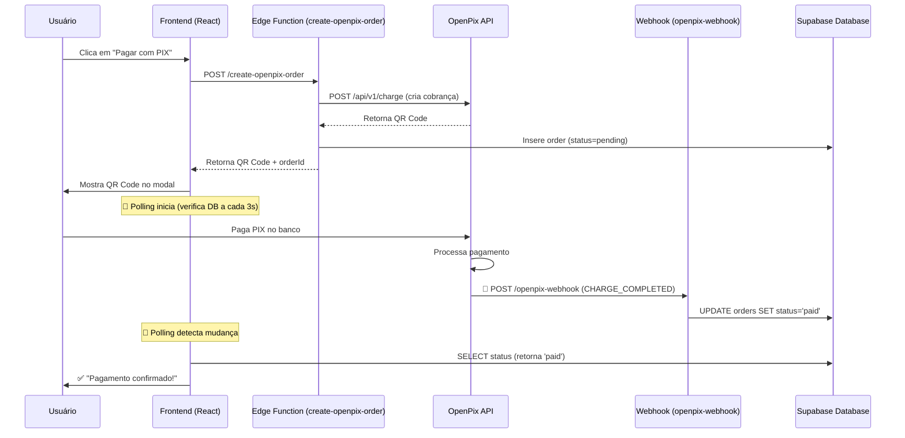

# ⚙️ Configurar Webhook OpenPix (OBRIGATÓRIO)

## 🚨 **PROBLEMA**

O pagamento PIX não confirma automaticamente porque o **webhook não está configurado** no dashboard OpenPix.

### Por que preciso do webhook?

- O SDK `@openpix/react` **NÃO DETECTA** pagamentos automaticamente
- O callback `onPay` **NUNCA será chamado** sem webhook
- **Única forma** de detectar pagamento: Webhook do servidor

---

## ✅ **PASSO A PASSO PARA CONFIGURAR**

### 1️⃣ Acessar Dashboard OpenPix

1. Entre em [https://app.openpix.com.br/](https://app.openpix.com.br/)
2. Faça login na sua conta

### 2️⃣ Navegar para Webhooks

1. No menu lateral, clique em **API/Integrações**
2. Clique em **Webhooks**
3. Clique no botão **"+ Novo Webhook"**

### 3️⃣ Configurar o Webhook

Preencha os seguintes campos:

| Campo             | Valor                                                                   |
| ----------------- | ----------------------------------------------------------------------- |
| **Nome**          | `Webhook Produção - BoraCorrer`                                         |
| **URL**           | `https://tdzdureusnszdzvsoomr.supabase.co/functions/v1/openpix-webhook` |
| **Evento**        | `OPENPIX:CHARGE_COMPLETED`                                              |
| **Authorization** | _(deixe em branco ou use uma senha se quiser validação extra)_          |
| **Ativo**         | ✅ **SIM**                                                              |

### 4️⃣ Salvar e Testar

1. Clique em **"Salvar"**
2. OpenPix deve mostrar uma mensagem de sucesso
3. Clique em **"Testar Webhook"** (botão ao lado do webhook criado)
4. Verifique se aparece ✅ Status 200 OK

---

## 🧪 **TESTAR SE FUNCIONA**

### Teste Manual

1. Acesse o site e crie um pedido de teste
2. Pague o PIX usando o QR Code gerado
3. **Aguarde 5-10 segundos**
4. O pagamento deve ser confirmado automaticamente

### Verificar Logs no Supabase

```sql
-- Ver logs do webhook
SELECT * FROM debug_logs
WHERE source = 'openpix-webhook'
ORDER BY created_at DESC
LIMIT 10;

-- Ver pedidos e status
SELECT id, status, correlation_id, payment_provider, created_at, updated_at
FROM orders
ORDER BY created_at DESC
LIMIT 5;
```

---

## 🔍 **VERIFICAR SE WEBHOOK ESTÁ FUNCIONANDO**

### 1. Verificar no Dashboard OpenPix

- Vá em **Webhooks** → Clique no webhook criado
- Veja a aba **"Histórico"** ou **"Logs"**
- Deve mostrar as chamadas HTTP feitas para seu endpoint

### 2. Verificar no Supabase

Execute no Editor SQL:

```sql
-- Últimos webhooks recebidos
SELECT
  created_at,
  message,
  details
FROM debug_logs
WHERE source = 'openpix-webhook'
ORDER BY created_at DESC
LIMIT 20;
```

**Você deve ver logs como:**

- ✅ "Webhook recebido (bruto)"
- ✅ "Event recebido: OPENPIX:CHARGE_COMPLETED"
- ✅ "Pedido encontrado e atualizado"

---

## ❌ **TROUBLESHOOTING**

### Problema: "Webhook não está sendo chamado"

**Solução 1: Verificar URL**

```
✅ CORRETO: https://tdzdureusnszdzvsoomr.supabase.co/functions/v1/openpix-webhook
❌ ERRADO: https://tdzdureusnszdzvsoomr.supabase.co/functions/v1/openpix-webhook/
❌ ERRADO: http://tdzdureusnszdzvsoomr.supabase.co/functions/v1/openpix-webhook (sem HTTPS)
```

**Solução 2: Verificar se Edge Function está deployada**

```bash
cd supabase/functions/openpix-webhook
supabase functions deploy openpix-webhook --no-verify-jwt
```

**Solução 3: Verificar evento selecionado**

- Deve ser exatamente: `OPENPIX:CHARGE_COMPLETED`
- ⚠️ NÃO selecione outros eventos como `CHARGE_CREATED`

### Problema: "Webhook retorna erro 401/403"

**Causa:** Edge Function exige autenticação

**Solução:** No arquivo do webhook, certifique-se que não há validação de autenticação:

```typescript
serve(async (req) => {
  // ✅ SEMPRE retornar 200 primeiro (sem validar auth)
  if (req.method === "OPTIONS") {
    return new Response(null, { headers: corsHeaders });
  }

  // NÃO VALIDAR TOKEN AQUI - OpenPix não envia Bearer token
  // ...resto do código
});
```

### Problema: "Pagamento demora muito para confirmar"

**Causa:** Webhook não está configurado, só polling funciona

**Solução:** Configure o webhook seguindo este guia

---

## 📊 **COMO FUNCIONA O FLUXO COMPLETO**



---

## ✅ **CHECKLIST FINAL**

Antes de testar novamente:

- [ ] Webhook criado no dashboard OpenPix
- [ ] URL correta (HTTPS, sem / no final)
- [ ] Evento: `OPENPIX:CHARGE_COMPLETED`
- [ ] Webhook marcado como **Ativo**
- [ ] Testado com botão "Testar Webhook" (deve retornar 200 OK)
- [ ] Edge Function `openpix-webhook` deployada
- [ ] Tabela `debug_logs` existe no Supabase
- [ ] Tabela `orders` tem coluna `correlation_id`

---

## 🎯 **RESULTADO ESPERADO**

Após configurar o webhook:

1. ✅ Usuário paga o PIX
2. ✅ OpenPix chama o webhook automaticamente (1-5 segundos)
3. ✅ Webhook atualiza `orders.status = 'paid'`
4. ✅ Polling detecta mudança (próximo ciclo de 3s)
5. ✅ **Frontend redireciona para página de sucesso**

**Tempo total:** ~5-10 segundos após pagamento 🎉

---

## 📞 **SUPORTE**

Se continuar com problemas:

1. Compartilhe os logs do webhook:

```sql
SELECT * FROM debug_logs
WHERE source = 'openpix-webhook'
ORDER BY created_at DESC;
```

2. Compartilhe screenshot do dashboard OpenPix mostrando:
   - Configuração do webhook
   - Histórico/logs de chamadas

3. Teste manualmente chamando o webhook:

```bash
curl -X POST https://tdzdureusnszdzvsoomr.supabase.co/functions/v1/openpix-webhook \
  -H "Content-Type: application/json" \
  -d '{
    "event": "OPENPIX:CHARGE_COMPLETED",
    "charge": {
      "status": "COMPLETED",
      "correlationID": "order_TESTE_12345",
      "transactionID": "txn_test"
    }
  }'
```

Deve retornar status 200 e você deve ver logs no Supabase.
