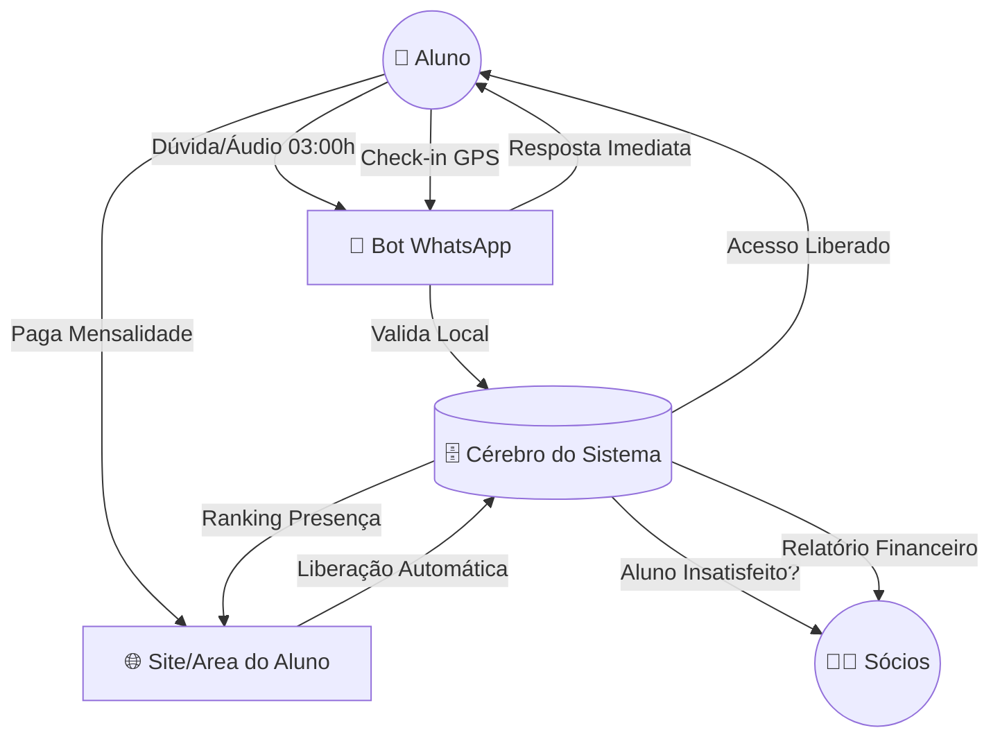

# 🚀 Bora Correr Club: O Sistema Operacional da Assessoria

> **Documento de Estratégia e Valor Tecnológico**
> _Por que nossa estrutura tecnológica vale por uma equipe inteira._

---

## 🧠 1. Mapa Mental do Ecossistema

Imagine o sistema dividido em 4 grandes pilares que conversam entre si 24h por dia:

### **A. O "Cérebro" (Supabase & Backend)**

_É onde tudo fica guardado e onde as decisões são tomadas._

- **Banco de Dados Central:** Guarda pagamentos, treinos, conversas e fichas de saúde.
- **Segurança:** Garante que só alunos ativos acessem o app.
- **Regras de Negócio:** Define inadimplência, cobrança de feedback e bloqueios.

### **B. O "Concierge" 🤖 (Bot do WhatsApp)**

_O funcionário que nunca dorme e atende instantaneamente._

- **Atendimento Inteligente:** Ouve áudios, transcreve e detecta sentimento negativo (insatisfação).
- **Check-in Automático:** Valida presença via GPS (Raio de 300m da Praça).
- **Comandos Rápidos:** `!planilha`, `!ranking`, `!pix`.

### **C. O "Gerente Proativo" 📢 (Automações)**

_O sistema trabalha ativamente sem você mandar._

- **Cobrança de Feedback:** Envia lembretes automáticos no sábado para garantir dados para os treinos.
- **Recuperação de Vendas:** Identifica quem desistiu no meio do cadastro e manda mensagem para recuperar.

### **D. O "Caixa" 💳 (Financeiro Automático)**

- **Múltiplos Gateways:** Stripe, OpenPix, InfinitePay.
- **Liberação Imediata:** Pagou o PIX -> Acesso liberado no App em 5 segundos.

---

## 📊 2. Fluxograma de Funcionamento

---

## ⚖️ 3. Comparativo: Simples vs. Estruturado

Aqui está o comparativo do custo real de operar no modelo manual versus o nosso sistema.

| Funcionalidade         | Modelo "Simples" (Manual)                                   | **Modelo Atual (Bora Correr OS)**                       |
| :--------------------- | :---------------------------------------------------------- | :------------------------------------------------------ |
| **Atendimento**        | Humano (Lento, falho, horário comercial).                   | **Híbrido (Bot 24h + Humano na exceção).**              |
| **Venda de Camiseta**  | 15 min de conversa no WhatsApp. Controle de estoque manual. | **0 min.** Aluno compra no site, estoque baixa sozinho. |
| **Inscrição Eventos**  | Lista de chamada no grupo (caos).                           | **Painel Organizado** com status de pagamento.          |
| **Feedback de Treino** | "Me conta como foi" (Baixa adesão).                         | **Régua de Cobrança Automática** (Alta adesão).         |
| **Financeiro**         | Conferência manual de comprovante PIX.                      | **Webhook Automático.** Pagou, liberou.                 |
| **Escala**             | Precisa de 1 funcionário a cada 50 alunos.                  | **Infinito.** Atende 1.000 alunos com mesmo custo.      |
| **Valor Percebido**    | "É um grupo de corrida".                                    | **"É uma Assessoria Premium com App Próprio".**         |

---

## 💎 4. Funcionalidades Detalhadas (O que o Aluno Vê)

### 🛍️ Loja Virtual & Estoque

- **Vitrine Online:** O aluno vê fotos e tamanhos disponíveis.
- **Baixa Automática:** Comprou a última peça P? O site marca como "Esgotado" na hora.
- **Histórico:** Sabemos quem comprou o quê para ações futuras.

### 🏃‍♂️ Área do Aluno & Saúde

- **Prontuário Digital:** Ficha de Anamnese completa (lesões, cirurgias, objetivos) acessível em 1 clique.
- **Central de Feedback:** Histórico de evolução e dores do aluno para o treinador consultar.

### 🎫 Eventos & Parcerias

- **Calendário de Provas:** Inscrição em 1 clique para eventos da assessoria.
- **Clube de Vantagens:** Área exclusiva com cupons de parceiros (argumento de venda para patrocínios).

---

## 🏆 5. Conclusão Final

A estrutura que criamos não é "complexidade", é **liberdade**.

Voltar para o modelo "simples" significa que os sócios terão que voltar a fazer trabalho operacional:

1.  Conferir PIX na conta bancária todo dia.
2.  Responder "qual o valor?" no WhatsApp 50x por dia.
3.  Cobrar feedback um por um.
4.  Controlar estoque de camiseta na mão.

O sistema trabalha operando a burocracia para que nós possamos focar no **Treino, na Estratégia e no Crescimento**.
