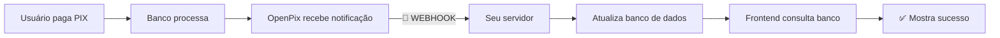

# 🔍 Por que o SDK @openpix/react NÃO DETECTA pagamentos automaticamente?

## ❌ **MITO: "O callback onPay vai detectar quando o usuário pagar"**

**REALIDADE:** O callback `onPay` do `@openpix/react` **NUNCA será chamado automaticamente** quando o pagamento for processado.

---

## 📘 **O QUE O SDK @openpix/react REALMENTE FAZ**

### ✅ O que ele FAZ:

1. **Criar cobranças PIX** via API OpenPix
2. **Gerar QR Code** (brCode e imagem)
3. **Mostrar modal** com QR Code
4. **Fornecer callbacks** para eventos LOCAIS

### ❌ O que ele NÃO FAZ:

1. ❌ Não monitora status de pagamento
2. ❌ Não consulta API OpenPix automaticamente
3. ❌ Não recebe notificações do banco
4. ❌ Não tem websocket/polling built-in
5. ❌ Não detecta quando usuário paga

---

## 🧪 **PROVA: Código do useOpenPixCharge**

Veja o código atual do nosso hook:

```typescript
export function useOpenPixCharge(options: UseOpenPixChargeOptions) {
  const [charge, setCharge] = useState<OpenPixCharge | null>(null);
  const [isPaid, setIsPaid] = useState(false);
  const [error, setError] = useState<string | null>(null);
  const [isLoading, setIsLoading] = useState(false);

  // 👇 Este callback NUNCA é chamado automaticamente
  const onPay = useCallback(
    (chargeResponse?: any) => {
      console.log("💰 onPay callback called", chargeResponse);
      setIsPaid(true);
      options.onPay?.(chargeResponse);
    },
    [options]
  );

  // ...resto do código
}
```

**Pergunta:** Quem chama `onPay()`?

**Resposta:** **NINGUÉM!** 😱

O SDK React apenas:

1. Cria a configuração do AppID
2. Fornece o componente `<OpenPixModal>`
3. **Espera que VOCÊ implemente a detecção de pagamento**

---

## 🎯 **COMO DETECTAR PAGAMENTOS NA PRÁTICA**

### Única solução correta: **Webhook do Servidor**



### ❌ Soluções INCORRETAS (não funcionam):

```typescript
// ❌ ERRADO #1: Esperar que onPay seja chamado
const { isPaid } = useOpenPixCharge({
  appID: OPENPIX_APP_ID,
  onPay: (charge) => {
    // 🚫 NUNCA VAI SER CHAMADO!
    console.log("Pagamento detectado");
  },
});

// ❌ ERRADO #2: Consultar API OpenPix direto do frontend
const checkPaymentStatus = async () => {
  // 🚫 NÃO FUNCIONA - precisa de auth do servidor
  const response = await fetch("https://api.openpix.com.br/api/v1/charge/" + id);
};

// ❌ ERRADO #3: Usar setTimeout esperando o pagamento
setTimeout(() => {
  setIsPaid(true); // 🚫 Como saber que foi pago?
}, 60000);
```

### ✅ Solução CORRETA:

```typescript
// ✅ CORRETO: Webhook + Polling do banco de dados
useEffect(() => {
  if (!orderId) return;

  const checkPaymentStatus = async () => {
    // 👇 Consulta SEU banco de dados
    const { data } = await supabase.from("orders").select("status").eq("id", orderId).single();

    // 👇 Webhook já atualizou o status
    if (data?.status === "paid") {
      setIsPaid(true);
    }
  };

  // Verificar a cada 3 segundos
  const interval = setInterval(checkPaymentStatus, 3000);
  return () => clearInterval(interval);
}, [orderId]);
```

---

## 📊 **COMPARAÇÃO: Expectativa vs Realidade**

### 😊 **EXPECTATIVA** (o que pensamos que acontece)

```
Usuário paga PIX
    ⬇️
OpenPix detecta automaticamente
    ⬇️
SDK React chama onPay()
    ⬇️
✅ isPaid = true
```

### 😢 **REALIDADE** (o que realmente acontece)

```
Usuário paga PIX
    ⬇️
OpenPix processa pagamento
    ⬇️
❓ SDK React não sabe de nada
    ⬇️
❌ onPay() NUNCA é chamado
    ⬇️
❌ isPaid continua false para sempre
```

### ✅ **SOLUÇÃO CORRETA** (webhook + polling)

```
Usuário paga PIX
    ⬇️
OpenPix processa pagamento
    ⬇️
📡 Webhook chama seu servidor
    ⬇️
💾 Servidor atualiza banco: status = "paid"
    ⬇️
🔄 Frontend polling detecta mudança
    ⬇️
✅ isPaid = true
```

---

## 🔬 **ANÁLISE TÉCNICA: Por que o SDK não pode detectar?**

### 1. **Arquitetura Cliente-Servidor**

O pagamento PIX acontece **fora do navegador**:

```
[Navegador com React] ❌ NÃO SABE ❌ [App do Banco]
```

Não há como o frontend "escutar" o banco!

### 2. **Segurança**

Se o frontend pudesse consultar status de pagamento:

```javascript
// 🚨 PERIGO: Hacker poderia fazer
fetch("https://api.openpix.com.br/api/v1/charge/" + anyChargeId)
  .then((r) => r.json())
  .then((data) => console.log("Status:", data.status)); // 🔓 Vazar dados
```

Por isso a API OpenPix exige **autenticação de servidor**.

### 3. **Limitações do React**

React roda no **navegador do cliente**:

```
React (navegador)
  ❌ Não pode receber webhooks (não é servidor)
  ❌ Não pode fazer requisições autenticadas (exporia chave secreta)
  ❌ Não pode "escutar" eventos do banco
```

---

## 💡 **ENTENDENDO OS COMPONENTES**

### SDK @openpix/react

**Função:** Facilitar criação de cobranças e exibir QR Code

```typescript
// O que o SDK faz:
const charge = await chargeCreate({
  correlationID: "order_123",
  value: 10000, // R$ 100,00
  customer: { name: "João", taxID: "123.456.789-00" },
});
// Retorna: { brCode, qrCodeImage, correlationID }

// O que o SDK NÃO faz:
// ❌ Detectar pagamento
// ❌ Atualizar status
// ❌ Validar se foi pago
```

### OpenPix API (Servidor)

**Recebe:** Pagamento do banco  
**Envia:** Webhook para seu servidor

```http
POST https://seu-servidor.com/webhook
Content-Type: application/json

{
  "event": "OPENPIX:CHARGE_COMPLETED",
  "charge": {
    "status": "COMPLETED",
    "correlationID": "order_123",
    "value": 10000
  }
}
```

### Seu Servidor (Edge Function)

**Recebe:** Webhook do OpenPix  
**Faz:** Atualiza banco de dados

```typescript
// openpix-webhook/index.ts
const data = await req.json();

if (data.event === "OPENPIX:CHARGE_COMPLETED") {
  await supabase
    .from("orders")
    .update({ status: "paid" })
    .eq("correlation_id", data.charge.correlationID);
}
```

### Seu Frontend (React)

**Consulta:** Banco de dados via polling

```typescript
// EscolherPagamentoProduto.tsx
useEffect(() => {
  const interval = setInterval(async () => {
    const { data } = await supabase.from("orders").select("status").eq("id", orderId).single();

    if (data?.status === "paid") {
      setIsPaid(true);
      navigate("/sucesso");
    }
  }, 3000);

  return () => clearInterval(interval);
}, [orderId]);
```

---

## 🎯 **CONCLUSÃO**

### ❌ **NÃO** dependa do SDK React para detectar pagamentos

O callback `onPay` é apenas uma **interface para eventos locais**, não detecta pagamentos reais.

### ✅ **SEMPRE** use esta arquitetura:

1. **Frontend**: Cria cobrança e mostra QR Code
2. **OpenPix**: Processa pagamento e envia webhook
3. **Servidor**: Recebe webhook e atualiza banco
4. **Frontend**: Consulta banco via polling

### 🔧 **SETUP OBRIGATÓRIO:**

1. ✅ Configurar webhook no dashboard OpenPix
2. ✅ Implementar edge function para receber webhook
3. ✅ Implementar polling no frontend para consultar banco
4. ✅ Atualizar status no banco quando webhook chegar

**SEM WEBHOOK = SEM DETECÇÃO DE PAGAMENTO** 🚫

---

## 📚 **RECURSOS ADICIONAIS**

- [Documentação oficial OpenPix: Webhooks](https://developers.openpix.com.br/docs/concepts/webhook)
- [Como configurar webhook](./CONFIGURAR_WEBHOOK_OPENPIX.md)
- [Arquitetura do sistema](./ARCHITECTURE.md)

---

## ✨ **RESUMO EM 3 PONTOS**

1. 🚫 **SDK React NÃO detecta pagamentos** - é só UI/helper para criar cobranças
2. 📡 **Webhook é OBRIGATÓRIO** - única forma oficial de receber notificações
3. 🔄 **Polling complementa** - permite UI responsiva enquanto aguarda webhook
